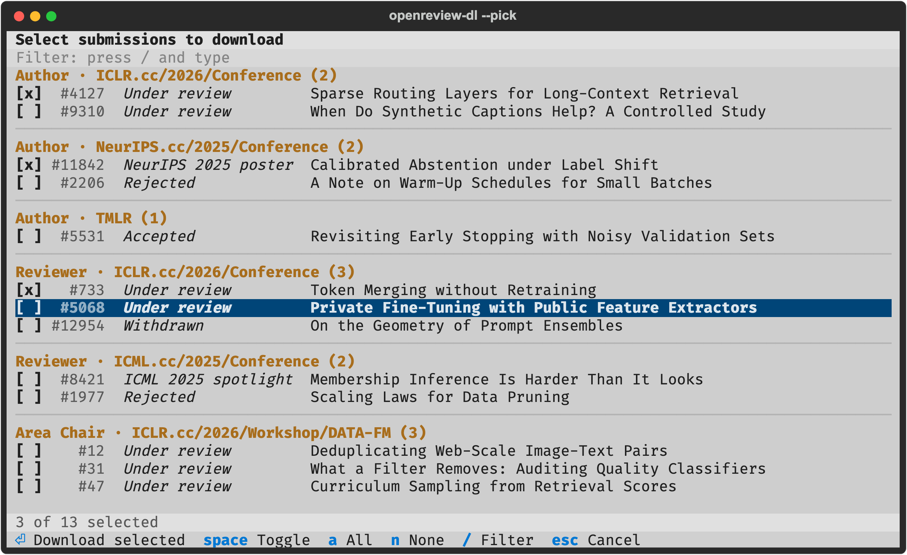
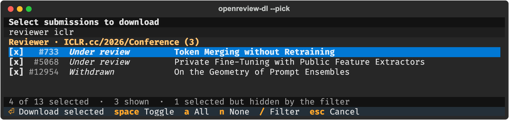

# openreview-dl

openreview-dl saves the discussion of an OpenReview submission (the reviews, the rebuttals and
every reply in between) as one readable document, in Markdown and ODT. Paste a forum URL, or let
it find every submission you wrote, review or chair and tick the ones you want in a terminal
selector.

<picture>
  <source media="(prefers-color-scheme: dark)" srcset="https://raw.githubusercontent.com/dwahdany/openreview-dl/main/docs/images/picker-dark.png">
  
</picture>

It is a command line tool for Python 3.11 and later. It logs in with your own OpenReview
account, so it sees exactly what you see on the website, including accounts with two-factor
login and machines that have no browser. (The submissions in the pictures are made up.)

## Install

You need [uv](https://docs.astral.sh/uv/getting-started/installation/) or pip, and Python 3.11
or later (uv fetches one by itself).

| | Command | Updates |
|---|---|---|
| **Run without installing** | `uvx openreview-dl` | Fetched on demand; `uvx openreview-dl@latest` forces the newest |
| **Install with uv** | `uv tool install openreview-dl` | `uv tool upgrade openreview-dl` |
| **Install with pip** | `pip install openreview-dl` | `pip install -U openreview-dl` |
| **Latest from GitHub** | `uvx --from git+https://github.com/dwahdany/openreview-dl openreview-dl` | Whatever is on `main` |

The selector and the `--pick`, `--all` and `--list` options are newer than release 0.4.0. Until
the next release is on PyPI, use the *Latest from GitHub* line to get them.

ODT files are written with [pandoc](https://pandoc.org). If it is not installed, the tool
downloads a copy on first use. The Markdown file is written first, so it is there even when
the ODT conversion fails.

To work on the code, see [DEVELOPMENT.md](DEVELOPMENT.md).

## Use

### One submission

```sh
openreview-dl
```

Paste the URL of the forum page (`https://openreview.net/forum?id=...`, copied from your author
or reviewer console) and log in when asked. You get two files:

- `output/<forum id>.md`: the Markdown document
- `output/<forum id>.odt`: the same for LibreOffice, Word or Pages

The document starts with the paper's title and abstract, then has one section per reviewer: the
review, followed by the replies to it in thread order. It is also printed to the terminal.
Downloading the same forum again keeps the earlier files and adds `_1`, `_2`, ... copies.

### Everything you have access to

```sh
openreview-dl --pick   # choose in the selector
openreview-dl --all    # download all of them
openreview-dl --list   # only print them
```

These find the submissions you authored and the ones you hold a role on (reviewer, area chair,
senior area chair, action editor, ...). Pressing Enter at the URL prompt without typing a URL
opens the selector too.

The selector groups submissions by role and venue.

| Key | Effect |
|---|---|
| `↑` `↓` (or `k` `j`), `PgUp` `PgDn` | Move |
| `Space`, or a mouse click | Tick or untick the row |
| `a` / `n` | Tick / untick every row that is shown |
| `/` | Filter; words match the title, venue, role, status or `#number` |
| `Esc` | In the filter: clear it. In the list: cancel |
| `Enter` | Download the ticked rows |



Ticks survive filtering, so you can filter, tick, filter for something else and tick again; the
status line says how many ticked rows the filter is hiding. The selector needs a real terminal
(it works over SSH); in a script or a pipe, use `--all` or `--list`.

Two options narrow and redirect the download:

- `--role ROLE` keeps only submissions where you are `ROLE`, for example
  `--all --role reviewer` or `--pick --role author,area-chair`.
- `--output-dir DIR` changes where the files go (default `output`).

Files are written to `DIR/<venue>/<number>_<title>_<forum id>.md` and `.odt`. Running the
command again replaces the files of the earlier run, so the directory always holds the current
state of each discussion. These documents contain every note you can read: reviews with their
threads first, then meta-reviews, decisions and other comments.

`--all` and `--pick` exit with status 0 only when every chosen submission was saved.

## Logging in

The tool asks for your OpenReview username and password and offers to remember them. Remembered
logins are stored encrypted in `~/.config/openreview-dl/`, in files only your user can read. The
key lies next to them, so this keeps the password out of plain sight but does not protect it
from someone who can use your account on that machine. The login session is remembered in the
same way until it expires, so the next run does not ask again. `openreview-dl --wipe-credentials`
deletes everything that was remembered.

### Two-factor login

If your account has two-factor login enabled, you choose a method after the password.
`emailOtp` and `totp` work anywhere: type the code when asked. `passkey` needs a browser, which
the tool opens for you on a desktop.

### Machines without a browser

For an SSH session, a server or a container, log in once on a machine that has a browser and
hand the login over:

1. On your laptop, run `openreview-dl --auth`. It logs in (the browser opens for the passkey)
   and prints a login token that stays valid for up to a week.
2. On the other machine, run `openreview-dl` as usual. Because it finds no browser, it offers to
   take a token before falling back to a password login. Paste the token at that prompt (the
   input is hidden). `--token TOKEN` also works but leaves the token in your shell history.

The token is checked against OpenReview, remembered like a password, and reused until it
expires; then repeat step 1. `--no-browser` (or `OPENREVIEW_DL_NO_BROWSER=1`) makes the tool
treat a machine as browserless when it does not notice by itself.

<details>
<summary>Finishing a passkey login over an SSH port forward instead</summary>

Choose `passkey` at the two-factor prompt on the remote machine. The tool prints the login URL
and this hint:

```
That page posts the token to 127.0.0.1:54321 on the browser's machine, so first
forward the port to this machine (use your usual user@host or ssh alias):

  ssh -L 54321:127.0.0.1:54321 you@remote-host
```

Run that on your laptop, open the URL in your local browser and finish the passkey prompt.
`--passkey-port PORT` (or `OPENREVIEW_DL_PASSKEY_PORT=PORT`) fixes the port, so that one
`LocalForward` line in your `~/.ssh/config` covers every login. A token that arrives this way
is only used after OpenReview confirms it belongs to your account.

</details>

## Options

| Option | Effect |
|---|---|
| `--pick` | Choose submissions in the selector and download them |
| `--all` | Download every submission you have access to |
| `--list` | Print the submissions you have access to |
| `--role ROLE` | With the three above: only submissions where you are `ROLE` (repeat it, or separate roles with commas) |
| `--output-dir DIR` | With `--pick` and `--all`: where the files go (default `output`) |
| `--auth` | Log in here and print a login token for a machine without a browser |
| `--token TOKEN` | Log in with such a token |
| `--no-browser` | Treat this machine as having no browser |
| `--passkey-port PORT` | Fixed local port for the passkey login |
| `--wipe-credentials` | Delete the remembered login and token |

`openreview-dl --help` prints the same list with more detail.

## Known limitations

- **Venues before 2023.** `--pick`, `--all` and `--list` only cover venues on the current
  OpenReview API (v2). Older venues that still use the legacy API are not listed.
- **Deleted submissions.** Papers you hold a role on but whose submission can no longer be read
  (usually because it was deleted) are named before the download starts and skipped.
- **Request limits.** OpenReview allows an account a few hundred requests per hour. Listing
  costs a few requests per venue, so ordinary accounts are far below that; if the limit
  is reached anyway, the tool stops with a message instead of saving an incomplete set.
- **Review text with its own markup.** A review that contains Markdown headings or unclosed HTML
  tags can disturb the layout of the ODT file. The Markdown file is unaffected.
- **Windows.** The tests run on Windows, but the selector has not been tried by hand there.

## License

[BSD 3-Clause](LICENSE).
